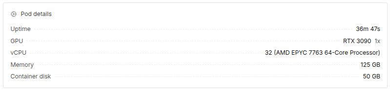

# GPU Benchmark

Benchmarks the performance difference between CPU and GPU when computing a sliding-window correlation matrix.

## Pod Configuration



Pod configuration parameters used for the benchmark:  
**GPU:** RTX 3090 1x  
**vCPU:** 32 (AMD EPYC 7763 64-Core Processor)  
**Memory:** 125 GB  
**Container disk:** 50 GB  

## Algorithm

The benchmark reads the `Data` column from `dataset.csv` as `float32`, creates sliding windows of size `60`, and normalizes each window using its mean and standard deviation.  
It then computes the pairwise correlation matrix in batches of `5000` windows using matrix multiplication (`(window_batch @ windows.T) / window_size`).  
Finally, it measures and compares the execution time on CPU (NumPy) and GPU (CuPy with CUDA stream synchronization).

## Terminal Output

```text
# python3 gpu_benchmark.py
Total windows: 10140, Window size: 60
CPU correlation matrix time: 0.9891 seconds
GPU (CuPy) correlation matrix time: 0.0025 seconds
```
